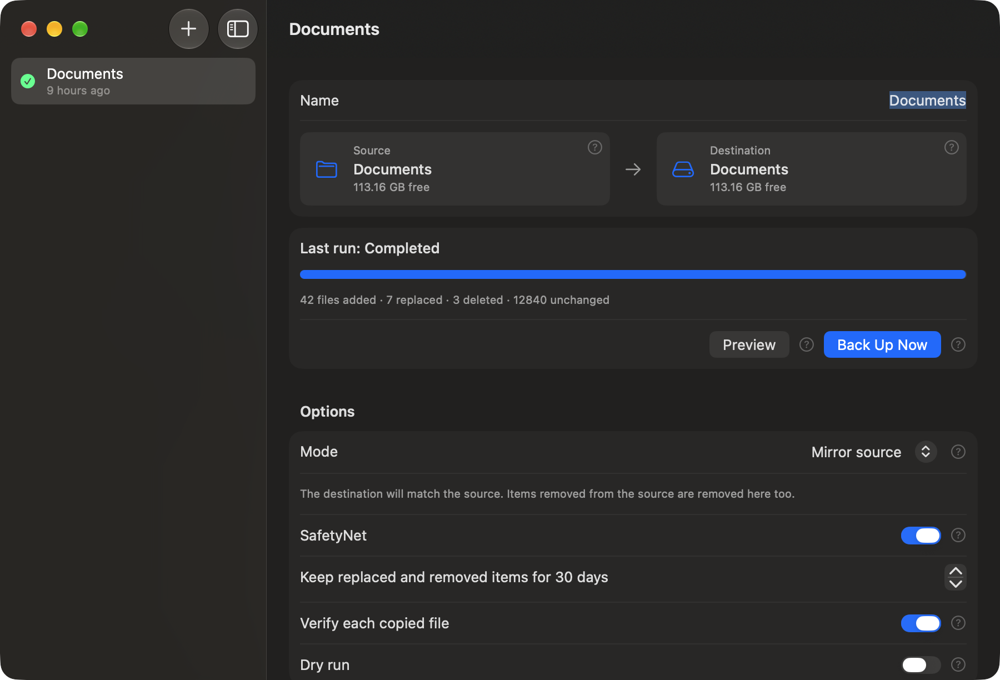

<p align="center">
  <picture>
    <source media="(prefers-color-scheme: dark)" srcset="Design/logo/logo-dark-bg.png">
    
  </picture>
</p>

A folder and disk backup app for macOS 14 or later. It copies only what changed, keeps replaced and removed files in a SafetyNet folder, and runs on a schedule even when the app is closed.

<p align="center">
  
</p>

## Features

- **Incremental backups** of any folder or disk, comparing size and modification time.
- **Mirror** or **add and update** modes.
- **SafetyNet** keeps replaced and removed files for 1 to 365 days.
- **Schedules** by interval, hour, day of the week or day of the month, even with the app closed.
- **Preview** and **Dry run** show what would be added, replaced, deleted and left unchanged.
- **Time left** estimates for both scanning and copying.
- **Pause** frees the CPU and disk, and continues by itself after 15 minutes.
- **Verification** of each copy with SHA-256.
- **Permission detection** that sends you to the right setting if macOS blocks a file.
- **Built-in help**, with a full guide and a question mark beside each important control.

## Install

Download the disk image for your Mac from the [latest release](https://github.com/half-paul/Twinplic/releases/latest):

| Mac | Download |
| --- | --- |
| Apple silicon (M1 or later) | `Twinplic-<version>-AppleSilicon.dmg` |
| Intel | `Twinplic-<version>-Intel.dmg` |

Open the disk image and drag Twinplic to Applications.

**The app isn't notarized by Apple**, so macOS blocks it the first time you open it. To allow it:

1. Try to open Twinplic, then choose **Done** in the warning.
2. Open **System Settings > Privacy & Security**, scroll down and choose **Open Anyway**.

Or run this in Terminal, after checking the download against `SHA256SUMS.txt` in the release:

```sh
xattr -dr com.apple.quarantine /Applications/Twinplic.app
```

## Using Twinplic

1. Choose **New Backup** with the + button, or press ⌘N.
2. Choose a **Source** and a **Destination**.
3. Choose **Preview** to see what would be copied. Nothing is changed.
4. Choose **Back Up Now**.

The full guide covers every feature and setting. Open it with **Help > Twinplic Help** or ⌘?, or from the menu bar icon. Click a question mark beside a control for a short explanation.

### Permissions

macOS asks for access the first time Twinplic reaches Desktop, Documents, Downloads, a removable disk or a network disk. Other protected data, such as Mail and Safari, needs Full Disk Access. An app can't grant that itself, so Twinplic detects the block and links to the setting. Turn on Twinplic in the list, then quit and reopen it.

## Data protection

- A run stops if a disk isn't mounted, including when a stale `/Volumes/Name` folder is left on the startup disk.
- Mirroring stops if the source is empty but the destination isn't.
- A non-empty destination without a `.twinplic-destination` marker needs explicit consent in the app. Scheduled runs never get that consent.
- A source folder that can't be read is skipped, and its backup stays in place.
- Files are copied to a temporary name and renamed once complete, so an interrupted run leaves no partial file under the real name.
- A file that changes while a paused run is half way through copying it is discarded, and copied on the next run.

## Limits

- Backups aren't bootable. Bootable copies need Apple's `asr` tool and a privileged helper.
- Hard links are copied as separate files.
- Clones within one APFS volume are instant, so the progress bar jumps per file there. Copies to another disk update as each file's data is written.
- Scheduled runs happen in a separate process with their own progress window, so the main window shows their result in History but not a live progress bar.
- A Mac that is shut down at the scheduled time misses that run. A sleeping Mac runs it on wake.
- Scanning a network share is limited by how fast the server lists folders, so a large share can take a long time before copying starts.
- Change detection uses size and modification time. "Verify each copied file" checks new copies with SHA-256, but doesn't re-check files that were skipped.
- Pause takes effect at the next checkpoint. Removing one large folder, cleaning up SafetyNet and cloning a file on APFS can't be interrupted.
- Time left is an estimate for the current stage. A scan's estimate doesn't include the copying that follows, because that isn't known until the scan ends.

## Build from source

You need Xcode and [XcodeGen](https://github.com/yonaskolb/XcodeGen).

```sh
xcodegen generate
xcodebuild -project Twinplic.xcodeproj -scheme Twinplic -configuration Release -derivedDataPath build build
open build/Build/Products/Release/Twinplic.app
```

For Intel Macs, use the `Twinplic-Intel` scheme, which has its own build folder:

```sh
xcodegen generate
xcodebuild -project Twinplic.xcodeproj -scheme Twinplic-Intel -configuration Release -destination 'generic/platform=macOS' -derivedDataPath build-intel build
```

`project.yml` signs with the maintainer's Apple Development certificate, so a Full Disk Access grant survives rebuilds. Without that certificate, add this to the `xcodebuild` command. You'll then need to grant access again after each build.

```sh
CODE_SIGN_IDENTITY=- CODE_SIGN_STYLE=Automatic DEVELOPMENT_TEAM=
```

Other commands:

- `swift test` runs the engine tests.
- `scripts/make-dmg.sh` builds both versions and writes disk images to `dist/`.
- `swift Design/make_brand.swift` regenerates the app icon and logos in `Design/logo`.

## How it works

| Part | Location | Job |
| --- | --- | --- |
| Planner | `Sources/TwinplicCore/Planner.swift` | Compares source and destination by size, modification time and symlink target. Writes nothing. |
| Engine | `Sources/TwinplicCore/BackupEngine.swift` | Applies a plan with `copyfile(3)`, keeping permissions, extended attributes and ACLs. Clones on APFS when it can. Handles pause and stop. |
| Preflight | `Sources/TwinplicCore/Preflight.swift` | Refuses runs that could damage data. |
| SafetyNet | `Sources/TwinplicCore/SafetyNet.swift` | Moves old items to `_Twinplic_SafetyNet/<UTC date>/` on the destination and prunes them by age. |
| Scheduler | `Sources/TwinplicCore/LaunchAgentScheduler.swift` | Writes one LaunchAgent per scheduled task, which runs `Twinplic --run-task <id>`. |
| Time estimates | `Sources/TwinplicCore/TimeEstimate.swift` | Works out the time left in a scan or copy. |
| Access checks | `Sources/TwinplicCore/AccessProblems.swift` | Sorts permission failures by cause and detects Full Disk Access. |
| App | `App/` | SwiftUI interface and menu bar icon. |
| Help | `App/HelpContent.swift` | Text for the Help window and the question mark popups. |
| Scheduled run panel | `App/ScheduledRunPanel.swift` | Floating progress window shown by launchd runs, with the current file, Pause and Stop. |

Tasks and history are stored in `~/Library/Application Support/Twinplic`.

## License

Copyright © 2026 Paul Uchitel. All rights reserved. No license is granted to use, copy, change or distribute this software or its source code.
